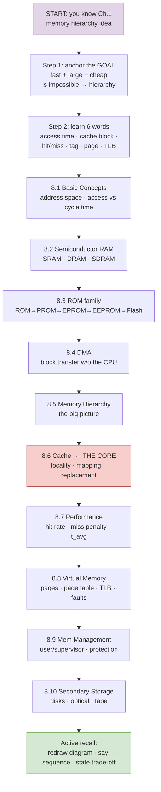
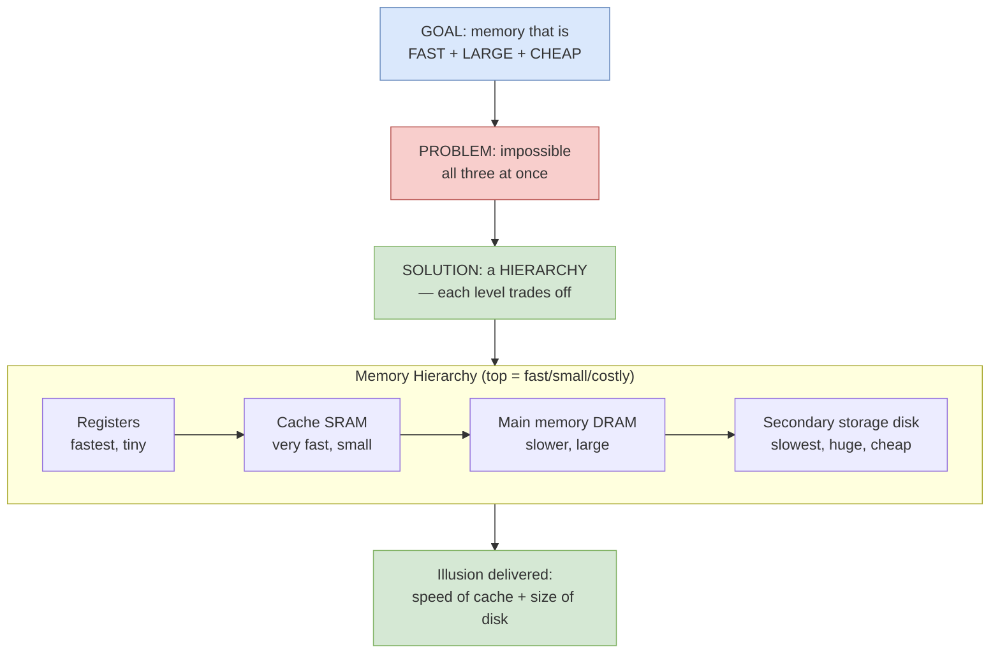
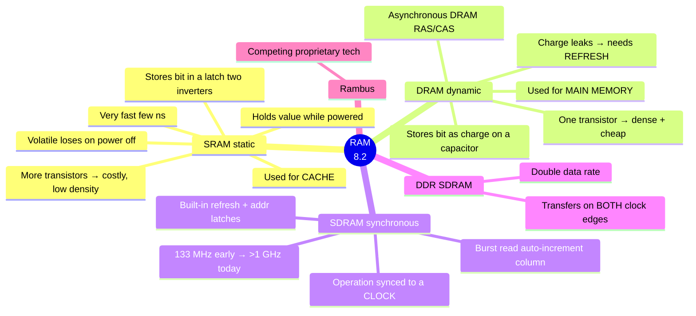
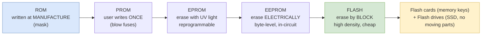
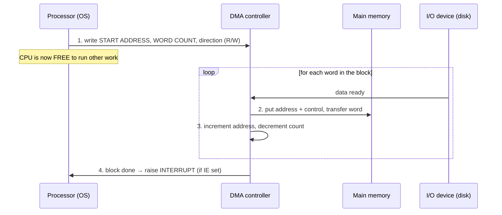
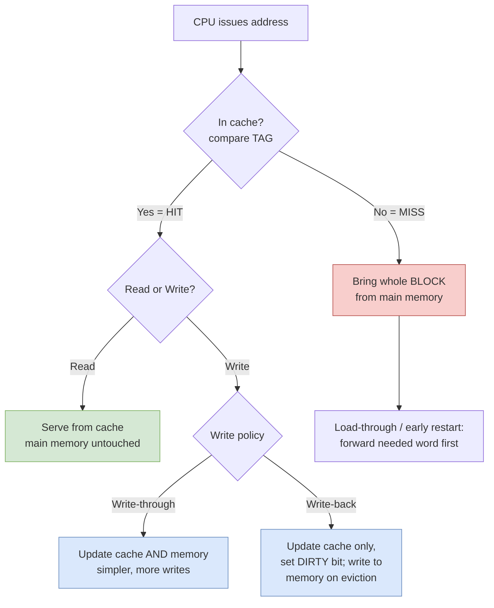
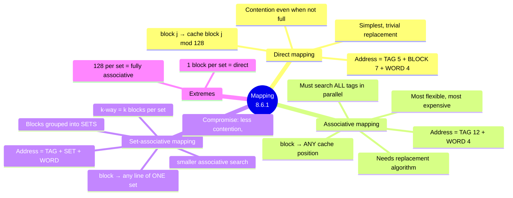
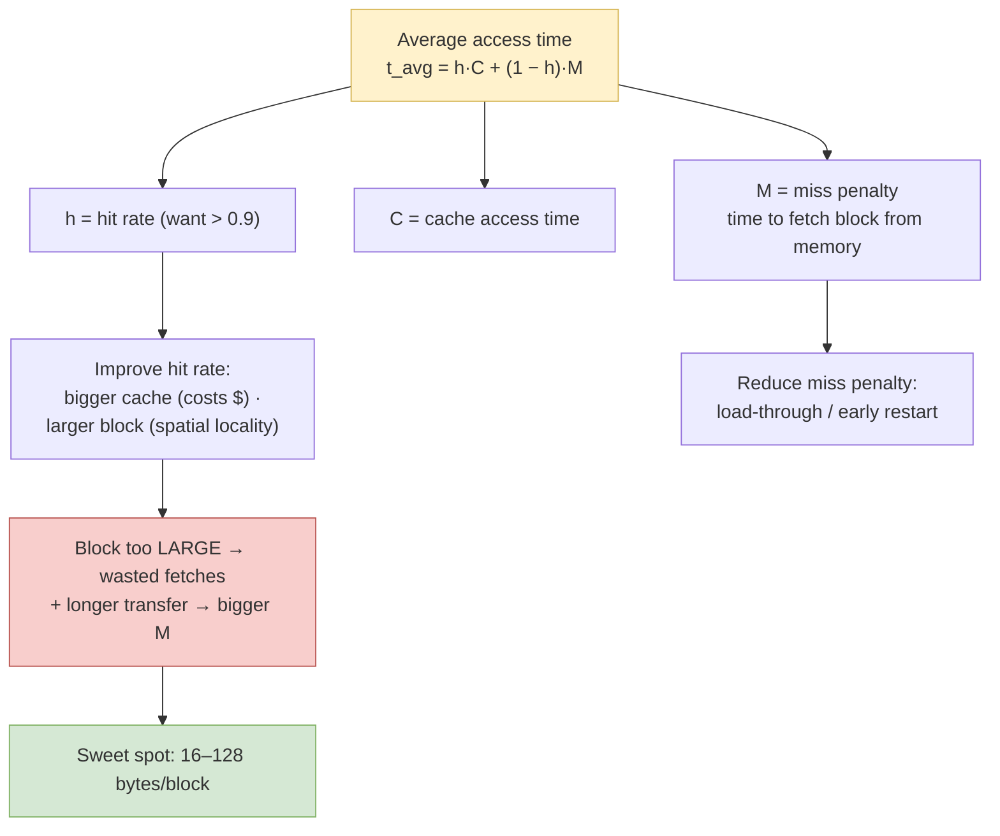
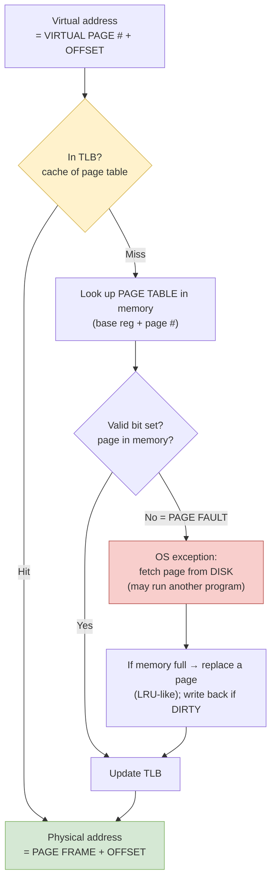
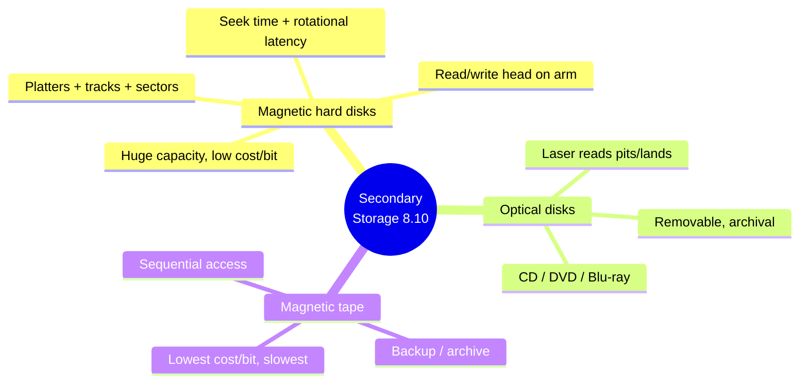

# Chapter 8 — The Memory System · Mind Maps

**Companion to:** `Chapter8_The_Memory_System_StudyGuide.md`

> View with any Mermaid-capable tool (VS Code + Mermaid extension, Obsidian, Typora,
> GitHub, GitLab). Each diagram also has a plain-text ASCII fallback. Export a single
> ```mermaid``` block to PNG/SVG at https://mermaid.live.

---

## Table of Contents
1. [How to Start Learning (the path)](#1-how-to-start-learning--the-path)
2. [Master Map — The Whole Chapter](#2-master-map--the-whole-chapter)
3. [Basic Concepts & the Memory Hierarchy](#3-basic-concepts--the-memory-hierarchy)
4. [Semiconductor RAM — SRAM vs DRAM vs SDRAM](#4-semiconductor-ram)
5. [Read-Only Memories (ROM family)](#5-read-only-memories)
6. [Direct Memory Access (flow)](#6-direct-memory-access)
7. [Cache — Hit/Miss & Write Policies (decision)](#7-cache--hitmiss--write-policies)
8. [Cache Mapping Functions](#8-cache-mapping-functions)
9. [Cache Performance — Average Access Time](#9-cache-performance)
10. [Virtual Memory & Address Translation (flow)](#10-virtual-memory--address-translation)
11. [Secondary Storage](#11-secondary-storage)

---

## 1. How to Start Learning — the path



**ASCII fallback:**
```
HOW TO START
START (you know Ch.1 memory-hierarchy idea)
  └─ Step 1: anchor the GOAL — fast+large+cheap is impossible → hierarchy solves it
      └─ Step 2: learn 6 words (access time · cache block · hit/miss · tag · page · TLB)
          └─ 8.1 Basic Concepts (address space, access vs cycle time)
              └─ 8.2 Semiconductor RAM (SRAM · DRAM · SDRAM)
                  └─ 8.3 ROM family (ROM→PROM→EPROM→EEPROM→Flash)
                      └─ 8.4 DMA (block transfer without the CPU)
                          └─ 8.5 Memory Hierarchy (big picture)
                              └─ 8.6 Cache  ← THE CORE (locality, mapping, replacement)
                                  └─ 8.7 Performance (hit rate, miss penalty, t_avg)
                                      └─ 8.8 Virtual Memory (pages, page table, TLB, faults)
                                          └─ 8.9 Mem Management (user/supervisor, protection)
                                              └─ 8.10 Secondary Storage (disks, optical, tape)
                                                  └─ ACTIVE RECALL: redraw · say sequence · state trade-off
```

---

## 2. Master Map — The Whole Chapter

```mermaid
mindmap
  root((Ch.8 The<br/>Memory System))
    8.1 Basic Concepts
      Address space from address width
      Access time vs cycle time
      RAM = uniform access time
      Block transfers
    8.2 Semiconductor RAM
      Internal organization cells + word/bit lines
      SRAM latch fast volatile costly
      DRAM capacitor dense cheap needs refresh
      SDRAM clocked burst
      DDR two transfers per clock
    8.3 Read-Only Memories
      ROM mask programmed
      PROM fuse once
      EPROM UV erase
      EEPROM electrical erase
      Flash block erase - cards + drives
    8.4 Direct Memory Access
      DMA controller does transfer
      Registers addr + count + status
      CPU sets it up then interrupt at end
      Cycle stealing vs burst
    8.5 Memory Hierarchy
      Registers → cache → main → disk
      Faster+smaller+costlier at top
    8.6 Cache Memories
      Locality temporal + spatial
      Hit vs miss
      Write-through vs write-back
      8.6.1 Mapping direct/assoc/set-assoc
      8.6.2 Replacement LRU
    8.7 Performance
      Hit rate h / miss penalty M
      t_avg = hC + (1-h)M
      Bigger block up to a point
      Load-through
    8.8 Virtual Memory
      Virtual vs physical address
      Page + page frame
      Page table + base register
      TLB = cache for page table
      Page fault → OS fetches from disk
    8.9 Memory Management
      System vs user space
      Supervisor vs user mode
      Protection + privileged instr
      Shared pages
    8.10 Secondary Storage
      Magnetic hard disks
      Optical CD/DVD
      Magnetic tape
```

**ASCII fallback:**
```
Ch.8 THE MEMORY SYSTEM
├── 8.1 BASIC CONCEPTS: address space (from addr width), access vs cycle time, RAM=uniform, block transfers
├── 8.2 SEMICONDUCTOR RAM: cells + word/bit lines
│      SRAM (latch, fast, volatile, costly) · DRAM (capacitor, dense, cheap, needs REFRESH)
│      SDRAM (clocked, burst) · DDR (2 transfers/clock)
├── 8.3 ROM FAMILY: ROM(mask) → PROM(fuse,once) → EPROM(UV erase) → EEPROM(elec erase) → FLASH(block erase; cards+drives)
├── 8.4 DMA: controller does the transfer; regs = start addr + word count + status; CPU sets up, interrupt at end; cycle-steal vs burst
├── 8.5 MEMORY HIERARCHY: registers → cache → main → disk (faster/smaller/costlier at top)
├── 8.6 CACHE: locality (temporal+spatial), hit/miss, write-through vs write-back
│      ├── 8.6.1 Mapping: direct / associative / set-associative
│      └── 8.6.2 Replacement: LRU (and others)
├── 8.7 PERFORMANCE: hit rate h, miss penalty M; t_avg = hC + (1-h)M; bigger block (to a point); load-through
├── 8.8 VIRTUAL MEMORY: virtual vs physical addr, page/page-frame, page table + base reg, TLB (cache for page table), page fault→OS fetch
├── 8.9 MEM MANAGEMENT: system vs user space, supervisor vs user mode, protection + privileged instrs, shared pages
└── 8.10 SECONDARY STORAGE: magnetic hard disks · optical CD/DVD · magnetic tape
```

---

## 3. Basic Concepts & the Memory Hierarchy

The chapter's founding tension: you cannot have **fast + large + cheap** all at once.



**ASCII fallback:**
```
BASIC CONCEPTS + HIERARCHY (8.1, 8.5)
 GOAL: fast + large + cheap  →  PROBLEM: impossible at once  →  SOLUTION: a HIERARCHY

 KEY TERMS
  • Address space  = set of addressable locations (k-bit address → 2^k locations)
  • Access time    = init → complete of ONE transfer
  • Cycle time     = min delay between two successive operations (slightly > access time)
  • RAM            = access time same for any location (vs serial disk/tape)

 HIERARCHY (top = faster, smaller, costlier per bit)
   Registers  →  Cache (SRAM)  →  Main memory (DRAM)  →  Secondary storage (disk)
 ILLUSION delivered to CPU: access time of cache + capacity of disk
```

---

## 4. Semiconductor RAM



**ASCII fallback:**
```
SEMICONDUCTOR RAM (8.2)
├── SRAM (static): bit held in a LATCH (2 inverters); volatile; VERY FAST (few ns);
│       many transistors → costly, low density → used for CACHE
├── DRAM (dynamic): bit = CHARGE on a capacitor; leaks → needs periodic REFRESH;
│       1 transistor/cell → dense + cheap → used for MAIN MEMORY; async uses RAS/CAS
├── SDRAM (synchronous): clocked; built-in refresh + address latches; BURST read
│       (auto-increment column); ~133 MHz early → >1 GHz today
├── DDR SDRAM: transfers on BOTH clock edges → double data rate
└── Rambus: competing proprietary technology
MEMORY HOOK: Static = sits still (latch) · Dynamic = drains (capacitor, refresh)
```

---

## 5. Read-Only Memories

An **evolution** map — each ROM type fixes the previous one's limitation.



**ASCII fallback:**
```
READ-ONLY MEMORIES (8.3) — nonvolatile; evolution of "how do we (re)write it?"
  ROM     → written at MANUFACTURE (mask programmed)
  PROM    → user programs ONCE (blow fuses)
  EPROM   → erase with UV light, reprogram (whole chip)
  EEPROM  → erase ELECTRICALLY, byte-level, in-circuit
  FLASH   → erase by BLOCK (sector); high density + cheap
            └─ Flash CARDS (memory keys / USB) and Flash DRIVES (SSD; solid-state, no moving parts)
```

---

## 6. Direct Memory Access

A **sequence/flow** map — how a block moves without the CPU babysitting it.



**ASCII fallback:**
```
DIRECT MEMORY ACCESS (8.4) — move a BLOCK directly between I/O device and memory
 WHY: program-controlled transfer = huge CPU overhead per word (poll/interrupt + address + count)
 DMA CONTROLLER REGISTERS: (1) starting address  (2) word count  (3) status/control
      status bits: R/W (direction) · IE (interrupt-enable) · Done · IRQ
 SEQUENCE
   1. CPU (OS) writes start addr + word count + direction → then is FREE
   2. DMA controller supplies address + control signals, transfers each word
   3. increments address, keeps track of word count
   4. when whole block done → sets Done, raises INTERRUPT
 SHARING THE BUS: cycle stealing (one word at a time) vs burst/block mode
```

---

## 7. Cache — Hit/Miss & Write Policies

A **decision** map — what happens on every access and how writes propagate.



**ASCII fallback:**
```
CACHE OPERATION (8.6) — built on LOCALITY OF REFERENCE
  • Temporal locality: a recently used item is likely used again soon
  • Spatial  locality: items near a used item are likely used soon → fetch a BLOCK (line)

 ON EACH ACCESS: compare TAG →
   HIT  → Read: serve from cache (memory untouched)
          Write: write-through (cache + memory, simpler, more writes)
                 write-back    (cache only + DIRTY bit; memory updated on eviction) ← common
   MISS → copy the whole BLOCK from main memory into cache, then serve
          load-through/early restart: forward the requested word first (less waiting)
 Separate I-cache and D-cache avoid structural stalls (ties to Ch.6 §6.7).
```

---

## 8. Cache Mapping Functions

Running example: cache = 128 blocks × 16 words; main memory = 64K words = 4K blocks; 16-bit address.



**ASCII fallback:**
```
MAPPING FUNCTIONS (8.6.1)  [example: 128 cache blocks, 16 words/block, 64K main = 4K blocks, 16-bit addr]

 DIRECT         : block j → cache block (j mod 128)
                  address = TAG(5) | BLOCK(7) | WORD(4)
                  + simplest, replacement trivial   − contention even when cache not full

 ASSOCIATIVE    : block → ANY cache position
                  address = TAG(12) | WORD(4)
                  + most flexible  − must search ALL tags in parallel (costly); needs replacement algo

 SET-ASSOCIATIVE: lines grouped into SETS; block → any line of ONE set
                  address = TAG | SET | WORD ; k-way = k blocks/set
                  COMPROMISE: less contention than direct, cheaper search than associative

 EXTREMES: 1 block/set = direct mapping · 128 blocks/set = fully associative
 PERFORMANCE RANK: associative > set-associative > direct (but set-assoc = best practical)
```

---

## 9. Cache Performance



**ASCII fallback:**
```
CACHE PERFORMANCE (8.7)
  AVERAGE ACCESS TIME:  t_avg = h*C + (1 - h)*M
     h = hit rate (high hit rates > 0.9 essential) · C = cache access time · M = miss penalty
  MISS PENALTY (1-level example): M = τ + 10τ + 7τ + τ = 19τ  (initial access + first word + 7 words + forward)

  IMPROVE HIT RATE: larger cache (↑cost) · larger block (exploit spatial locality)
  REDUCE MISS PENALTY: load-through / early restart (resume as soon as needed word arrives)

  BLOCK SIZE TRADE-OFF: too small → poor spatial use; too large → wasted fetches + bigger M
       → popular range 16–128 bytes per block
```

---

## 10. Virtual Memory & Address Translation

A **flow** map — turning a virtual address into a physical one, and what a page fault triggers.



**ASCII fallback:**
```
VIRTUAL MEMORY + ADDRESS TRANSLATION (8.8)
 IDEA: only ACTIVE pages live in main memory; the rest stay on DISK → program sees memory larger than physical RAM
 UNITS: virtual address = VIRTUAL PAGE # + OFFSET ; a page-sized slot in RAM = PAGE FRAME

 PAGE TABLE: one entry per page → page frame + control bits (valid, modified/dirty, access rights)
   located via PAGE TABLE BASE REGISTER + virtual page number
 TLB: small associative cache of the most-recent page-table entries (inside the MMU)

 TRANSLATION
   virtual addr → check TLB
     • TLB hit  → physical addr = page frame + offset
     • TLB miss → read page table in memory → update TLB
         • valid? → translate
         • NOT valid = PAGE FAULT → OS exception → load page from disk
             (if RAM full → replace a page LRU-style; write back first if DIRTY)
 NOTE: write-BACK only (disk too slow for write-through)
```

---

## 11. Secondary Storage



**ASCII fallback:**
```
SECONDARY STORAGE (8.10) — nonvolatile, bottom of hierarchy
├── MAGNETIC HARD DISKS: platters/tracks/sectors; head on arm; SEEK time + ROTATIONAL latency;
│       huge capacity, lowest cost/bit among online storage
├── OPTICAL DISKS: CD / DVD / Blu-ray; laser reads pits & lands; removable, good for archival
└── MAGNETIC TAPE: SEQUENTIAL access; backup/archive; lowest cost/bit, slowest access
```

---

*End of mind maps. Pair with the study guide for full detail.*
